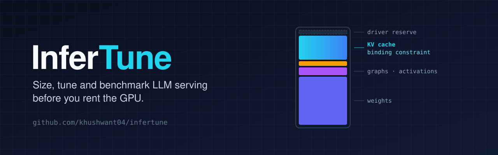
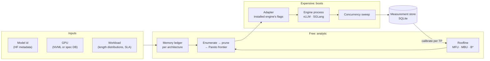

<div align="center">



A GPU-aware configuration profiler for LLM inference. Give it a model, a GPU, a serving engine and a workload, and it finds a safe, near-optimal deployment configuration. It also shows the memory arithmetic that justifies it.

[](https://github.com/khushwant04/infertune/actions/workflows/ci.yml)


[](LICENSE)
[](https://github.com/khushwant04/infertune/releases)

[Quickstart](#quickstart) · [Tune on a GPU](#tune-on-a-gpu) · [How it works](#how-it-works) · [Docs](#documentation) · [Status](docs/status.md)

</div>

---

InferTune answers three questions that are usually answered by guessing:

- **Will this model fit, and at what concurrency?**
- **What is the actual limit:** VRAM, the KV cache, or compute?
- **What would I need to rent to serve this?** You can ask before you rent it.

The output is not just a config. It is a **ledger**: every number traces to a term in the memory model or the roofline model, and InferTune always names the **binding constraint**, so it can answer "why not higher?"

> [!NOTE]
> **v0.1.0 is a pre-release.** The memory model is validated against real vLLM on an A10 (worst case **3.61%** off on KV capacity). The throughput model, SGLang, tp > 1 and `tune --execute` have not yet been run on a GPU. See the [changelog](CHANGELOG.md) and [what is measured](docs/status.md).

## Features

**Plan without a GPU**
- A full memory ledger (weights, CUDA graphs, activations, logits, fragmentation, KV) for 16 NVIDIA GPUs. Run `infertune gpus` to list them.
- Model facts from checkpoint metadata over HTTP range requests. No weights are downloaded. Weight bytes are byte-exact on 20 of 20 checkpoints tested.
- Per-architecture cache models: GQA, MLA, attention/Mamba hybrids, interleaved local/global attention.
- A sampled aggregate working set, never per-request percentiles added together.

**Compile to the engine you actually have**
- vLLM and SGLang adapters introspect the **installed** engine's argument schema; there are no hardcoded flag tables.
- When the absolute KV lever is missing, the adapter falls back to an inverted memory fraction, and says so.
- Startup-log parsers recover the KV pool each engine really allocated.

**Search by boot cost**
- Enumerate the restart-required space, prune it analytically to a Pareto frontier, and only then spend boots.
- `tune --execute` boots each survivor, sweeps concurrency on that one boot, records every run and picks the measured winner.
- Stored runs calibrate the roofline for that exact GPU, model, engine version and TP degree.

## Quickstart

Requires Python 3.11+. Planning needs no GPU and no CUDA toolchain.

```bash
git clone https://github.com/khushwant04/infertune.git && cd infertune
pip install -e .                 # add [nvml] on a GPU host; set HF_TOKEN for gated models
```

```bash
infertune plan --model Qwen/Qwen3-8B --gpu a10 --max-num-seqs 64 --max-model-len 8192
```

```
Qwen/Qwen3-8B on 1x NVIDIA A10  (tp=1)
AttentionSpec, 36/36 layers cache state; weights measured via safetensors-header (sharded)

term                       bytes  formula
total VRAM             23.94 GiB  device capacity (binary units)
usable after driver    21.57 GiB  total - driver/display reservation
driver/vGPU reserve     2.37 GiB  total - torch-allocatable (outside the engine's budget)
model weights          15.26 GiB  measured checkpoint bytes / tp=1
CUDA graph pool       364.00 MiB  64.00 MiB base + 64 captured sizes x hidden/tp x 1200 B
attention workspace   128.00 MiB  attention backend scratch
prefill activations   512.00 MiB  8192 tokens x (hidden+intermediate)/tp x 2 elements
logits + sampling     111.28 MiB  64 seqs x 151936 vocab x 4 B x 3
fragmentation safety  662.56 MiB  3% of usable VRAM
KV cache budget         4.58 GiB  usable - everything above

KV capacity             33,314 tokens (144.00 KiB/token, bf16)
concurrency headroom    23 (requested 64)
critical batch size B*  130
binding constraint      kv_working_set — the KV cache budget, not compute, limits concurrency
verdict                 cache is the wall: a smaller KV dtype or more GPUs would help; a faster
                        GPU would not

! composing per-request p95 lengths would have read 163,840 tokens against an actual aggregate
p95 of 87,343 (1.88x overstated)
```

Then rank configurations, still without a GPU:

```console
$ infertune tune --model Qwen/Qwen3-8B --gpu a10 --boots 5
enumerated 15 -> 5 to boot (3x fewer)
  0 infeasible (no KV budget), 10 dominated (another candidate is at least as good on KV
  capacity and predicted throughput)

#  configuration                   KV tokens  pred tok/s  pred TTFT  headroom
1  tp=1 len=4096 seqs=256 kv=bf16     26,361        1895      280ms        18
2  tp=1 len=4096 seqs=128 kv=bf16     32,210        1495      280ms        22
3  tp=1 len=4096 seqs=64 kv=bf16      35,135        1052      280ms        24
4  tp=1 len=4096 seqs=32 kv=bf16      36,597         660      280ms        25
5  tp=1 len=4096 seqs=16 kv=bf16      37,328         378      280ms        26

dry run: would boot 5 configurations and sweep concurrency on each. Re-run with --execute on
the serving host to measure them.
```

## Tune on a GPU

On the serving host, with vLLM (or SGLang) installed:

```bash
pip install -e ".[nvml]"
infertune tune --model Qwen/Qwen3-8B --execute --boots 5 --ttft-p99-ms 2000
```

For each surviving candidate, `--execute`:

1. compiles the plan against the installed engine's own flags;
2. starts the engine on a fresh port in its own process group, logging to `infertune-runs/`;
3. waits for `/health`, and notices right away if the engine dies during startup (for example an OOM);
4. sweeps client-side concurrency on that one boot, stopping at saturation or an SLA breach;
5. stops the whole process group, so no worker keeps holding GPU memory;
6. records the run, with the KV pool the engine really allocated, in `infertune.db`.

It then prints the measured winner and the command to serve it. A failed boot is reported with the end of its log, and the search moves on to the next candidate. The next `tune` reads `infertune.db` and calibrates its predictions from runs on the same GPU, model, engine version and TP degree.

The [GPU runbook](docs/gpu-runbook.md) walks through a full validation session.

## How it works



Boots cost minutes, while changing client-side concurrency costs seconds, and one boot yields a whole latency–throughput curve. So the search is budgeted in **boots**, and everything that can be decided analytically is decided before one is spent. On a synthetic objective with a known ground truth, this picked the same winner as an exhaustive 30-boot grid using **5 boots**, with a **0.00%** throughput gap.

Naive sizing is not off by a few percent. On DeepSeek-V3's MLA cache it overestimates by **56.9x**, and on Nemotron-H's attention/Mamba hybrid by **13x**. [The correction factors →](docs/status.md#correction-factors-the-estimator-applies)

## CLI

| Command | GPU needed | What it does |
| --- | --- | --- |
| `plan` | no | Size a configuration for hardware you do not have yet. |
| `tune` | no | Rank candidates analytically (dry run). |
| `tune --execute` | yes | Boot, sweep and record each candidate; report the measured winner. |
| `profile` | yes | Plan on detected hardware and print a runnable command for the installed vLLM. |
| `benchmark` | yes | Sweep concurrency against a running engine and record the curve. |
| `kv` | no | KV cache cost per token. |
| `working-set` | no | Aggregate in-flight KV tokens for a workload. |
| `gpus` | no | List the GPU specification database. |

## Design commitments

Five decisions shape everything else. The full rationale is in [`docs/plan.md` §2](docs/plan.md).

1. **The workload distribution is a required input.** Paged engines allocate KV per *token*; `max_num_seqs × max_model_len` is an admission limit, not a reservation. The aggregate p95 is *sampled*. Adding per-request p95 lengths together overstates the tail by about 1.8x.
2. **Carry bytes, never fractions.** vLLM's `--gpu-memory-utilization` covers weights, activations and KV. SGLang's `--mem-fraction-static` covers weights and KV only. The same `0.88` describes different machines.
3. **Introspect the installed engine.** Flags drift fast enough to rot a static table in two releases, and they fail *silently*. vLLM 0.19.1 lacks the `--kv-cache-memory` flag the plan assumed, and SGLang moved its entire argument surface between releases.
4. **Partition the search by restart cost.** Do the analytic pruning first, and measure only the survivors.
5. **The core does not import torch.** Hardware facts enter through a `GPUProfile` from NVML *or* the spec database. An AST test enforces it.

<details>
<summary><b>Architecture and repository layout</b></summary>

<br>

A framework-independent resource model, with thin adapters translating to engine flags. Dependencies only point downward.

```
CLI → Reporter → Search Orchestrator → { Resource Estimator, Framework Adapters, Runner }
                                              ↓                    ↓
                                       Core domain models (pure, no torch)
                                              ↓
                            { Hardware Discovery, Model Analyzer } → Measurement Store
```

| Path | What |
| --- | --- |
| `src/infertune/core` | Units, dtypes, cache specs, model, GPU, plan, workload (stdlib only) |
| `src/infertune/models` | safetensors header reader, HF config analyzer |
| `src/infertune/estimator` | Memory ledger, roofline, calibration |
| `src/infertune/hardware` | NVML discovery, GPU specification database |
| `src/infertune/adapters` | vLLM, SGLang, registry |
| `src/infertune/bench` | Load generator, metrics, concurrency sweep |
| `src/infertune/search` | Space enumeration, pruning, search orchestration |
| `src/infertune/runner` | Engine lifecycle and the boot-and-measure executor |
| `src/infertune/store` | SQLite measurement store |
| `scripts/` | Azure A10 provisioning and the vLLM validation script |

Adding SGLang needed **zero** changes outside `adapters/`.

</details>

## Scope

InferTune **recommends and benchmarks**. It does not own production deployment: it emits configs for whatever does.

Out of scope by choice: multi-node, disaggregated prefill/decode, speculative decoding, LoRA, MIG and non-NVIDIA hardware.

## Development

```bash
pip install -e ".[dev]"

ruff check src tests scripts
ruff format --check src tests scripts
mypy                                # strict
pytest                              # CPU-only: no GPU, no model download, no engine
pytest -m network --run-network     # opt-in tests against the Hugging Face Hub
```

`tune --execute` is tested end to end against `tests/fake_engine.py`, a real subprocess that replays a recorded vLLM startup log and serves the streaming API. That covers process groups, readiness, early-exit detection and store records without a GPU.

CI runs the suite on Python 3.11, 3.12 and 3.13, plus the core-purity check. Pushing a `v*` tag runs the [release workflow](.github/workflows/release.yml), which builds the wheel and creates the GitHub release from the changelog.

## Documentation

| Topic | Docs |
| --- | --- |
| Design | [Design plan](docs/plan.md): memory model derivation, performance model, adapter mapping, milestones, risks |
| Evidence | [Status](docs/status.md): what is built, what is measured, what remains · [A10 validation](docs/gpu-validation-a10.md) |
| Operations | [GPU runbook](docs/gpu-runbook.md): the next validation session, step by step |
| Project | [Changelog](CHANGELOG.md) · [Docs index](docs/README.md) |

## License

InferTune is licensed under the [Apache License 2.0](LICENSE). See [`NOTICE`](NOTICE).

## Author

Built by [Khushwant Sanwalot](https://github.com/khushwant04) · [Hexel Studio](https://hexelstudio.com)
